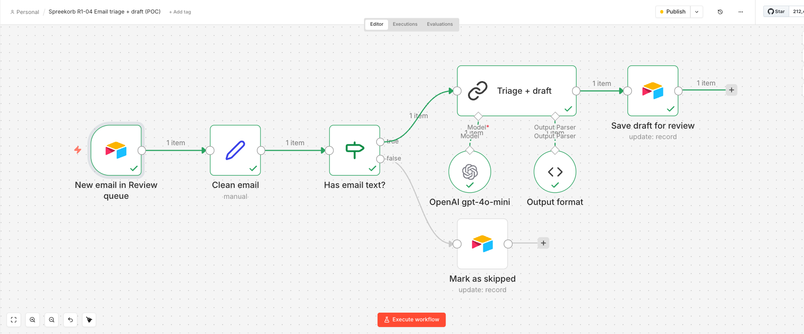
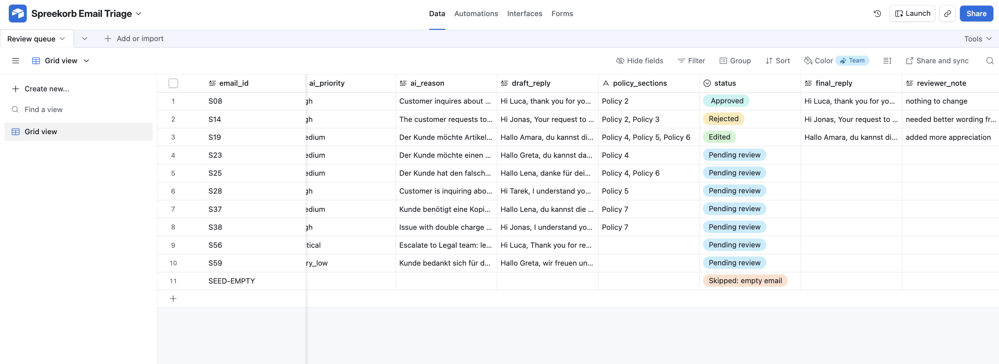

# n8n workflow documentation: R1-04 (UC1 email triage + draft)

Card R1-04, spec `specs/R1-04_n8n_poc.md`. Workflow: `n8n/workflow.json` (8 nodes, inactive on import). Written by `notebooks/R1-04_n8n_poc.ipynb`. Synthetic emails only.

## Purpose
UC1 for Spreekorb email customer service. For each new email the AI suggests a queue and a priority, gives a one-line reason and writes a reply draft. A person reads every draft and decides: approve, edit or reject. No email is sent: the workflow has no email node, it only writes back to the Airtable table Review queue.

## Nodes
The spec asks for 3 steps: trigger, AI triage + draft, output for human review. The workflow keeps 8 nodes (Ayhan's decision). The extra nodes are small helpers, and each one belongs to one of the 3 steps. The model and the output parser are sub-nodes of Triage + draft, not extra steps.

| # | Node (n8n type) | What it does | Why it fits | Spec step |
|---|---|---|---|---|
| 1 | New email in Review queue (Airtable Trigger) | Checks the Review queue table every minute for rows with a new `created` time | Airtable is the inbox for the POC, so no real mailbox is needed | trigger |
| 2 | Clean email (Edit Fields) | Keeps record_id, email_id, subject and body, trims spaces | Only the fields the AI needs are passed on (data minimisation) | trigger |
| 3 | Has email text? (If) | Body not empty: go to the AI. Empty: go to Mark as skipped | No AI cost and no invented draft for an empty email | AI triage + draft (guard) |
| 4 | Triage + draft (Basic LLM Chain) | Sends subject and body with system prompt v5 (`n8n/triage_prompt.md` plus the knowledge base) | Same prompt as tested in LangSmith (R1-05); cell 5 checks the node text against `triage_prompt.md` | AI triage + draft |
| 5 | OpenAI gpt-4o-mini (sub-node of 4) | The model, temperature 0.2 | Low cost per draft (see R1-05), low temperature for steady output | AI triage + draft |
| 6 | Output format (Structured Output Parser, sub-node of 4) | Forces JSON: language, queue, priority, reason, draft_reply, policy_sections | Only allowed queue and priority values reach Airtable | AI triage + draft |
| 7 | Save draft for review (Airtable update) | Writes the AI fields, status `Pending review`, model `gpt-4o-mini, prompt v5`, processed_at | The person sees draft, reason and cited policy sections side by side | output for human review |
| 8 | Mark as skipped (Airtable update) | Sets status `Skipped: empty email` | An empty email stays visible to a person instead of vanishing | output for human review |

## Setup
1. Airtable: create base Spreekorb Email Triage and table Review queue with the 16 fields in `n8n/airtable_setup.md`.
2. n8n: Workflows > Import from file > `n8n/workflow.json`.
3. Credentials in n8n: add an Airtable Personal Access Token credential and an OpenAI credential. Select the Airtable one in the 3 Airtable nodes (the trigger and both update nodes) and the OpenAI one in the model node. Keys stay in n8n, never in this repo.
4. In the 3 Airtable nodes replace `PASTE_BASE_ID` (app...) and `PASTE_TABLE_ID` (tbl...) with the ids from the Airtable URL. Refresh the column list in both update nodes.

## How to run
1. Activate the workflow first, then import `n8n/airtable_seed.csv` into Review queue (11 synthetic rows, all status `New`: 10 tuning emails with 10 topics, 5 de and 5 en, plus SEED-EMPTY). The trigger only picks up rows created after activation (`airtable_setup.md`, step 6), so within about a minute it fetches the new rows. For a single check you can also use Test workflow.
2. Check in Airtable: the 10 email rows change to status `Pending review`, with ai_language, ai_queue, ai_priority, ai_reason, draft_reply and policy_sections filled.
3. Check that SEED-EMPTY becomes `Skipped: empty email` and gets no draft.
4. Human review: set 3 rows to Approved, Edited or Rejected and fill final_reply or reviewer_note. Nothing is sent. reviewer_note and final_reply must not contain agent names, agent IDs or other personal data.
5. Deactivate the workflow after the test (the trigger polls every minute).

## Link to evaluation
Prompt v5 in the Triage + draft node is the version tested in LangSmith (R1-05). Held-out set spreekorb-heldout-20 (20 synthetic emails, never used for tuning, human labels by Ayhan), experiment heldout-v5-489260bd. Figures copied from `langsmith/monitoring_note.md`, not recomputed:

| Evaluator (held-out, share passing) | Result |
|---|---|
| queue_match | 85% |
| priority_match | 70% |
| priority_within_one | 95% |
| no_banned_phrase | 100% |
| escalation_flagged | 100% |
| language_match | 100% |
| word_count | 100% |
| signoff_ok | 100% |
| no_unknown_status | 100% |

Time and cost: 20 drafts traced, average 2.21 s, 3099.2 tokens in / 129.8 out, total 0.007591 USD (LangSmith, measured). Code checks test form, not truth, so a person still reviews every draft. Only 20 emails: this shows the method works, it does not prove quality yet.

## Limits vs production
- Synthetic emails only, no real Spreekorb customers.
- Polling trigger (every minute) on an Airtable table, not a live mailbox or webhook.
- No error workflow, retry or alert yet (Round 2).
- Live n8n runs are not traced in LangSmith; only the R1-05 notebook runs are (Round 2).
- A person reviews every draft. No email is sent automatically.
- Processors: OpenAI (model), Airtable (table) and n8n (workflow and execution logs; EU cloud region or self-hosted). Before any real customer data, each needs a data processing agreement, a transfer basis (SCCs or DPF) and an EU region where offered. Set n8n execution data pruning. OpenAI API data retention and no-training terms are to be confirmed in the DPA. The works agreement is still a draft (`langsmith/monitoring_note.md`). This POC is prepared for compliance, not proof of it.
- EU AI Act (our assessment, not legal advice): a drafting assistant where a person reviews and sends every reply is likely minimal or limited risk, with no direct AI-to-customer contact. Automatic sending would need a new transparency review. Staff who use the tool need AI literacy (Art. 4).
- Works council: no agent names or IDs in Airtable (no Assignee or Last modified by fields). Approval and edit rates are reported at team level only, minimum group of 5.

## Screenshots
Placeholders, Ayhan adds the files:
- Workflow in n8n: `n8n/screenshots/workflow.png`

  
- Airtable review view: `n8n/screenshots/airtable_review.png`

  
